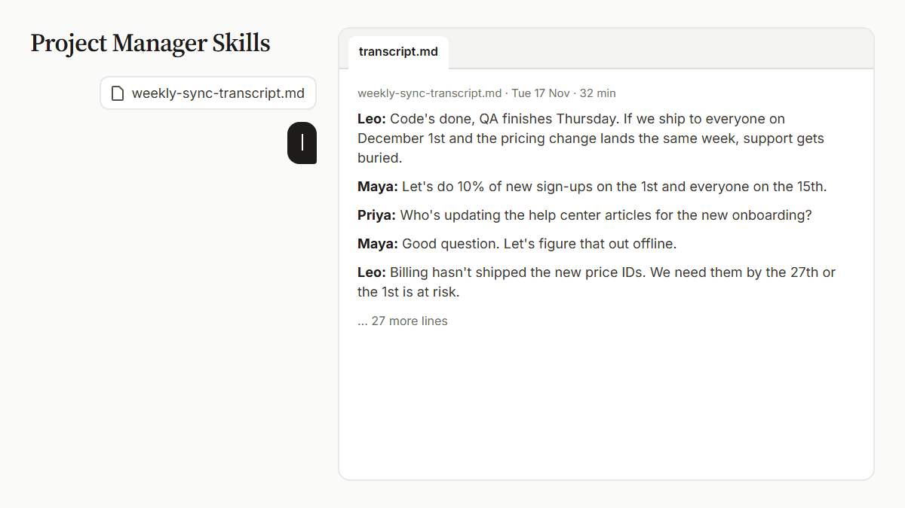

# Project Manager Skills

Seventeen open-source project manager skills for **Claude Code**, **Claude Cowork**, **claude.ai** and **OpenAI Codex**: meeting minutes, meeting agendas, a decision log, action items, a RAID log, status reports, 1:1s, skip-level meetings, standups, retrospectives, a morning brief, a project charter, a team charter, change control, a RACI matrix, a stakeholder map with a communication plan, and a lessons learned register.



They are written for project managers, and they work just as well for team leads, engineering managers and product managers who run meetings and keep projects on track. Any agent that reads the open [Agent Skills](https://agentskills.io) format can use them.

The skills share one folder of plain Markdown files. Whatever a meeting decides shows up in the next agenda, the Friday status report and tomorrow's morning brief, without you copying anything between them.

```
kickoff ──────► project-charter ──► PROJECT.md: goal, scope, milestones, who decides
transcript ───► meeting-minutes ──► DECISIONS.md, ACTIONS.md, RAID.md ──► meeting-agenda
                                                                      ├─► status-report
                                                                      ├─► standup
                                                                      └─► morning-brief
"can we add…" ► change-control ───► CHANGES.md ──► the agenda, for whoever decides
launch review ► lessons-learned ──► LESSONS.md ──► the next project's charter and RAID log
how we work ──► team-charter ─────► TEAM.md ─────► the retro checks the agreements
```

## Try it in five minutes

1. Get the skills:
   - **Claude Code:** `/plugin install project-manager-skills --marketplace numal-ai/project-manager-skills`
   - **Codex, Cursor, GitHub Copilot and other agents:** `npx skills add numal-ai/project-manager-skills`
   - **claude.ai or Claude Cowork:** download the [starter pack](https://github.com/numal-ai/project-manager-skills/releases/latest/download/project-manager-skills-starter.zip) and unzip it. Upload the three skill ZIPs inside it in **Customize → Skills**.
2. Paste the notes or the transcript of your last meeting and say: `Write minutes from this meeting.`
3. Then say: `Prep the agenda for our next meeting.`

The agenda opens with what the minutes left open. That's the point of the set: each skill picks up where the last one stopped.

## Start here by situation

| Your situation | Skills, in order | Say this first |
|---|---|---|
| A meeting just ended and you have the transcript or notes | `meeting-minutes` → `action-items` | "Write minutes from this transcript, then draft the follow-ups" |
| The next meeting is tomorrow | `meeting-agenda` | "Prep the agenda for tomorrow's sync from what's still open" |
| It's Friday and stakeholders want an update | `status-report` | "Write my Friday status update for stakeholders" |
| You're starting a project and just had the kickoff | `project-charter` → `raci-matrix` → `stakeholder-map` | "Write the project charter from this kickoff transcript" |
| You just took over a project | `raid-log` → `decision-log` → `meeting-agenda` | "Read these docs and start a RAID log and a decision log" |
| Someone wants to add work, move a date or spend more | `change-control` | "Sales wants bulk import in v1. Write a change request with the impact" |
| Nobody is sure who decides, or who needs to hear | `raci-matrix`, `stakeholder-map` | "Who's accountable for the rollout dates? Who needs to hear that billing is late?" |
| Someone asks why we decided something | `decision-log` | "Why did we pick a staged launch? Show me the source" |
| The standup thread is long and you need the blockers | `standup` | "Summarise today's standup: blockers first, and who can unblock them" |
| You have a 1:1 coming up | `one-on-one` | "Prep my 1:1 with Sam tomorrow" |
| You manage managers and meet the people on their teams | `skip-level-meeting` | "Prep my skip-level with Sam tomorrow" |
| Someone new joins, or the team keeps tripping over how it works | `team-charter` | "Write up our team charter from this how-we-work talk" |
| The sprint or project just ended | `retrospective` → `lessons-learned` | "Plan our sprint retro from these notes" |
| You're about to do something the team has done before | `lessons-learned` | "Have we run a launch like this before? What did we learn?" |
| It's morning and you don't know where to start | `morning-brief` | "Brief me" |

Each skill reads what the earlier ones saved, so the second step needs no copying. An empty folder is fine to start with: the first skill asks once before it saves anything.

[Worked examples on one demo project](#one-demo-project-every-skill) show the output of every skill.

## The skills

| Skill | What it does | Say something like |
|---|---|---|
| [meeting-minutes](skills/meeting-minutes/SKILL.md) | Turns a transcript or notes into minutes: decisions accepted and not accepted, action items with owners and dates, risks, open questions, and a recap message | "Write minutes from this Zoom transcript" |
| [meeting-agenda](skills/meeting-agenda/SKILL.md) | Builds an agenda from what's open: overdue actions, decisions due for a revisit, risks, leftovers from last time. Each item gets an outcome, a lead and a time box. Kickoff agendas too | "Prep the agenda for Tuesday's sync" |
| [decision-log](skills/decision-log/SKILL.md) | Keeps a decision register: records decisions, finds past ones with their source, flags contradictions and decisions due for a revisit | "Why did we pick a staged launch?" |
| [action-items](skills/action-items/SKILL.md) | One action list across meetings: who does what by when, what's overdue, polite follow-ups. Creates tracker tickets with the meeting context, after you confirm | "What's overdue, and turn these into Jira tickets" |
| [raid-log](skills/raid-log/SKILL.md) | RAID log / risk register: risks, assumptions, issues and dependencies, each with an owner, a mitigation and a "what changed" review | "Update the RAID log from this week's notes" |
| [status-report](skills/status-report/SKILL.md) | Weekly project status report with an honest RAG status, built from the record. Also rolls several projects up into one page | "Write my Friday update for stakeholders" |
| [one-on-one](skills/one-on-one/SKILL.md) | 1:1 prep and notes with your reports or your manager, in a private running doc per person | "Prep my 1:1 with Sam" |
| [standup](skills/standup/SKILL.md) | Async standup summary with blockers first and who can unblock them, plus work that hasn't moved | "Summarise today's standup thread" |
| [retrospective](skills/retrospective/SKILL.md) | Sprint retros, project post-mortems and lessons learned, grounded in what happened. Ends with a few owned actions the next retro checks | "Plan our sprint retro" |
| [morning-brief](skills/morning-brief/SKILL.md) | One page of what needs you today: decide, unblock, do, plus prep for today's meetings. Reads your files and connected tools, never writes to them | "Brief me" |
| [project-charter](skills/project-charter/SKILL.md) | Writes the project charter from the kickoff: goal, measurable success, scope in and out, milestones, who decides. Seeds the RAID log, decisions and first actions | "Write the project charter from this kickoff transcript" |
| [change-control](skills/change-control/SKILL.md) | Turns "can we also add…" into a change request with the impact on scope, dates, money, people and risks. Keeps the change log and updates the plan once the owner decides | "Sales wants SSO in v1. Write a change request" |
| [raci-matrix](skills/raci-matrix/SKILL.md) | RACI matrix with one accountable person per row, built from who actually does and decides the work. Flags gaps and bottlenecks | "Who's accountable for the rollout dates?" |
| [stakeholder-map](skills/stakeholder-map/SKILL.md) | Stakeholder map and communication plan: who cares, who has sway, who gets which update and how often | "Who needs to hear that billing is late?" |
| [lessons-learned](skills/lessons-learned/SKILL.md) | Lessons learned register and closure report. Brings the right lessons back when the next project starts, and says what came of past decisions | "What did we learn from the last launch?" |
| [team-charter](skills/team-charter/SKILL.md) | Team charter and working agreements: what the team is for and owns, how it decides, its agreements and meetings. The retro checks that the agreements still hold | "Write up our team charter from this transcript" |
| [skip-level-meeting](skills/skip-level-meeting/SKILL.md) | Skip-level prep and private notes, then the themes of a round without names, and what to take back to the lead | "Prep my skip-level with Sam tomorrow" |

## Which project manager skills they cover

Most lists of project manager skills agree on the same core: communication, risk management, planning, leadership, problem solving, time management and fluency with tools. PMI groups them into ways of working, power skills and business acumen. These skills take over the routine part of each one. You keep the judgment, the relationships and the final say.

| Project manager skill | What the agent does for you |
|---|---|
| Communication and stakeholder updates | `stakeholder-map` decides who hears what, how and how often. `status-report` writes the weekly update for the team, stakeholders or executives, with an honest RAG status and what you need from the reader. `meeting-minutes` drafts the recap message. Nothing is sent without your yes |
| Risk management | `raid-log` keeps the RAID log (risk register, issue log, assumptions, dependencies), each row with an owner and a real mitigation, and prepares the top risks for a steering meeting |
| Meeting facilitation | `meeting-agenda` builds the agenda from what is still open, with an outcome, a lead and a time box per item. `meeting-minutes` records what was decided and who does what |
| Decision making and governance | `decision-log` records what was decided, by whom and why, what was turned down, and when to revisit it. It answers "why did we decide X?" with the source |
| Organization and follow-through | `action-items` keeps one list of owners and due dates across meetings, drafts follow-ups and creates tracker tickets with the meeting context after you confirm |
| Project planning and scope | `project-charter` writes the charter from the kickoff: goal, measurable success, scope in and out, milestones and who decides. `meeting-agenda` plans the kickoff itself |
| Change control and scope creep | `change-control` turns each request into a change request with its impact, keeps the change log, and updates the plan only after the person with the right to decide says yes |
| Roles and responsibilities (RACI) | `raci-matrix` builds the RACI matrix, one accountable person per row, and answers "who decides on X?" |
| Time management and prioritization | `morning-brief` shows what needs you today: what to decide, unblock and do |
| Agile ceremonies | `standup` puts blockers first and spots work that hasn't moved. `retrospective` plans the retro and ends with a few owned actions |
| Leadership and coaching | `one-on-one` prepares 1:1s and keeps a private running doc per person. `skip-level-meeting` prepares skip-levels with the people on your leads' teams and brings back themes without names |
| Team building and ways of working | `team-charter` writes the team charter and working agreements from the team's own words, and the retro checks that they still hold |
| Lessons learned and project closeout | `retrospective` runs post-mortems from what actually happened. `lessons-learned` keeps the lessons register, writes the closure report, and brings the right lessons back when the next project starts |
| Reporting to leadership across projects | `status-report` rolls several projects or teams into one page, red and amber first |
| Tool and AI fluency | The skills run in Claude Code, Claude Cowork, claude.ai and Codex, and work with Jira, Linear, Asana, Trello or GitHub Issues when they are connected |

**Not covered yet:** scheduling, the work breakdown structure and Gantt charts, budgeting and cost control, resource and capacity planning, vendor management and quality acceptance. Issues and pull requests are welcome.

**Stays with you:** negotiation, conflict, adaptability and the relationships behind every update. The agent brings you the facts, and you make the call.

### What are the most important project manager skills?

Communication comes first on almost every list, followed by risk management, planning, leadership, problem solving and adaptability. Budgeting, agile methods and fluency with tools, now including AI, round out the core. Agents already do a large share of the routine around the first three: reports, minutes, follow-ups and spotting risks. The judgment and the relationships stay with the project manager. The table above shows which skill takes over which part.

## What the output looks like

From [a 32-minute weekly sync transcript](demo/weekly-sync-transcript.md), `meeting-minutes` writes [these minutes](demo/after/meetings/2026-11-17-weekly-sync.md) and starts the [decision log](demo/after/DECISIONS.md) and the [action list](demo/after/ACTIONS.md):

> **D-001 Accepted:** Launch the new onboarding to 10% of new sign-ups on 2026-12-01 and to everyone on 2026-12-15. Decided by Maya, Leo, Priya. Why: avoid both waves of support tickets in pricing week. Revisit 2026-12-08, before going to 100%.
>
> **D-002 Not accepted:** Move the whole launch to January. Why not: sales already promised December to two accounts.
>
> | A-001 | Write the rollout note for support | Priya | 2026-11-19 |
>
> **Open question:** Who updates the help center articles for the new onboarding? No owner yet.

### One demo project, every skill

Each skill has a worked example on the same made-up launch, in the order the project runs: the kickoff, one launch week, the weeks after it, and the review after the launch. Each one shows the request, the reply and the files written.

| Day | What happened | Example |
|---|---|---|
| Oct 5 | The kickoff transcript becomes the project charter | [project-charter](skills/project-charter/examples/charter-from-kickoff.md) |
| Mon | Sprint retro, from the plan to the write-up | [retrospective](skills/retrospective/examples/sprint-retro.md) |
| Tue | Weekly sync transcript becomes minutes, decisions and actions | [meeting-minutes](skills/meeting-minutes/examples/weekly-sync.md) |
| Tue | A RAID log started from the same minutes | [raid-log](skills/raid-log/examples/start-from-minutes.md) |
| Wed | «Brief me» at 08:30 | [morning-brief](skills/morning-brief/examples/launch-week-brief.md) |
| Wed | The Slack standup thread, blockers first | [standup](skills/standup/examples/launch-week-standup.md) |
| Wed | Prep for a 1:1 with an engineer stuck waiting on legal | [one-on-one](skills/one-on-one/examples/prep-with-sam.md) |
| Fri | A decision from the PM's notes, then «why did we…?» | [decision-log](skills/decision-log/examples/log-and-ask.md) |
| Fri | The action list updated from the week's notes | [action-items](skills/action-items/examples/friday-update.md) |
| Fri | The status report for a VP and a sales lead | [status-report](skills/status-report/examples/friday-status.md) |
| Fri | Next Tuesday's agenda, built from what's still open | [meeting-agenda](skills/meeting-agenda/examples/next-sync-agenda.md) |
| Fri | Sales asks for more in the December release: a change request, then the decision | [change-control](skills/change-control/examples/scope-change-request.md) |
| Fri | A RACI built from the folder, then «who decides…?» | [raci-matrix](skills/raci-matrix/examples/raci-from-records.md) |
| Fri | The stakeholder map and communication plan, then «who needs to hear?» | [stakeholder-map](skills/stakeholder-map/examples/communication-plan.md) |
| Nov 24 | After the sync, a how-we-work talk becomes the team charter | [team-charter](skills/team-charter/examples/charter-from-session.md) |
| Dec 2–3 | The VP's skip-levels with two engineers: prep, private notes, and themes to take back to the lead | [skip-level-meeting](skills/skip-level-meeting/examples/round-with-themes.md) |
| Dec 18 | Lessons from the retro and the launch review, and what came of the staged launch | [lessons-learned](skills/lessons-learned/examples/lessons-from-retro.md) |

## Install

### Claude Code

```
/plugin install project-manager-skills --marketplace numal-ai/project-manager-skills
```

On Claude Code older than 2.1.275, add the marketplace first:

```
/plugin marketplace add numal-ai/project-manager-skills
/plugin install project-manager-skills@numal
```

All seventeen add about 2,900 tokens to each session (their names and descriptions). A skill's full text loads only when you use it.

Want only some of the skills? Each one is also its own plugin, about 150 to 200 tokens each. Install the full set or single skills, not both, or each skill shows up twice.

```
/plugin install meeting-minutes --marketplace numal-ai/project-manager-skills
/plugin install meeting-agenda --marketplace numal-ai/project-manager-skills
/plugin install decision-log --marketplace numal-ai/project-manager-skills
/plugin install action-items --marketplace numal-ai/project-manager-skills
/plugin install raid-log --marketplace numal-ai/project-manager-skills
/plugin install status-report --marketplace numal-ai/project-manager-skills
/plugin install one-on-one --marketplace numal-ai/project-manager-skills
/plugin install standup --marketplace numal-ai/project-manager-skills
/plugin install retrospective --marketplace numal-ai/project-manager-skills
/plugin install morning-brief --marketplace numal-ai/project-manager-skills
/plugin install project-charter --marketplace numal-ai/project-manager-skills
/plugin install change-control --marketplace numal-ai/project-manager-skills
/plugin install raci-matrix --marketplace numal-ai/project-manager-skills
/plugin install stakeholder-map --marketplace numal-ai/project-manager-skills
/plugin install lessons-learned --marketplace numal-ai/project-manager-skills
/plugin install team-charter --marketplace numal-ai/project-manager-skills
/plugin install skip-level-meeting --marketplace numal-ai/project-manager-skills
```

Or copy single skills into your skills folder:

```bash
git clone https://github.com/numal-ai/project-manager-skills
cp -R project-manager-skills/skills/meeting-minutes ~/.claude/skills/
```

### Any agent, one command

The open [skills](https://github.com/vercel-labs/skills) installer puts the skills where your agent looks for them: Claude Code, Codex, Cursor, GitHub Copilot, Gemini CLI and many others. It asks which agents and which skills.

```bash
npx skills add numal-ai/project-manager-skills
```

One skill only:

```bash
npx skills add numal-ai/project-manager-skills --skill meeting-minutes
```

### claude.ai and Claude Cowork

Download a ready ZIP from the [latest release](https://github.com/numal-ai/project-manager-skills/releases/latest):

| Download | What's inside |
|---|---|
| [Starter pack](https://github.com/numal-ai/project-manager-skills/releases/latest/download/project-manager-skills-starter.zip) | meeting-minutes, meeting-agenda and status-report. The best first download |
| [All skills](https://github.com/numal-ai/project-manager-skills/releases/latest/download/project-manager-skills-all.zip) | All seventeen |
| Single skill | `https://github.com/numal-ai/project-manager-skills/releases/latest/download/<skill>.zip`, for example [meeting-minutes.zip](https://github.com/numal-ai/project-manager-skills/releases/latest/download/meeting-minutes.zip) |

1. Unzip the pack. Inside are one ZIP per skill.
2. Upload those skill ZIPs in **Customize → Skills** (on older versions, **Settings → Capabilities → Skills**). Don't upload the pack itself.
3. Start a new chat and say what you need, for example `Write minutes from this transcript`.

In Cowork you can also add this repository as a plugin marketplace in **Customize → Plugins**. More in [docs/claude-cowork.md](docs/claude-cowork.md).

### OpenAI Codex

Copy the skills into your personal skills folder:

```bash
git clone https://github.com/numal-ai/project-manager-skills
mkdir -p ~/.agents/skills
cp -R project-manager-skills/skills/* ~/.agents/skills/
```

Or add the repository as a plugin marketplace with `codex plugin marketplace add numal-ai/project-manager-skills`, then install **project-manager-skills** from the plugins directory.

Restart Codex if the skills don't show up. Call one directly with `$meeting-minutes`.

### ChatGPT, Cursor and other agents

Any tool that supports Agent Skills loads the folders in `skills/` as they are. Step-by-step guides:

- [ChatGPT](docs/chatgpt.md)
- [Cursor](docs/cursor.md)
- [Claude Cowork](docs/claude-cowork.md)
- [OpenAI Codex](docs/codex.md)

## The shared folder

The skills keep their records in the folder you work in. The first time one of them wants to save something, it asks you once.

```
PROJECT.md   DECISIONS.md   ACTIONS.md   RAID.md   CHANGES.md   LESSONS.md   TEAM.md (optional)
meetings/   one-on-ones/   skip-levels/   standups/   retros/   reports/
```

Formats and rules are in [docs/workspace.md](docs/workspace.md). In short:

- **Nothing is invented.** Unclear items become questions or are marked `(check)`.
- **Rows are never deleted.** Their status changes instead.
- **IDs stay stable:** `D-001`, `A-001`, `R-001`, `CR-001`, `L-001`.

## Safety

- **Nothing goes to other people without your yes.** Tracker tickets, recap messages and chat posts are first shown to you as an exact list. Tickets and messages notify people, so they are never a side effect.
- **Few questions.** Everything that needs your yes comes as one list with one question. Most runs ask for none or one.
- **The plan stays yours.** No skill changes dates, budget or scope on its own. `change-control` prepares the change with its impact, and the person with the right to decide makes the call.
- **The morning brief is read-only.** It reads your calendar, tracker, email and chat and never acts in them.
- **1:1 and skip-level notes stay private.** Nothing from `one-on-ones/` or `skip-levels/` is copied into shared files unless you ask. What leaves a skip-level leaves as a theme, without names.
- **No servers, no accounts, no telemetry.** These are instructions plus Markdown files. Your data stays wherever your agent already runs.

## Templates without an agent

If you'd rather fill a template by hand, these are copy-paste versions of the same formats:

- [meeting recap](https://numal.ai/templates/meeting-recap?utm_source=github&utm_medium=readme&utm_campaign=project-manager-skills&utm_content=templates)
- [decision log](https://numal.ai/templates/decision-log?utm_source=github&utm_medium=readme&utm_campaign=project-manager-skills&utm_content=templates)
- [action items](https://numal.ai/templates/action-items?utm_source=github&utm_medium=readme&utm_campaign=project-manager-skills&utm_content=templates)
- [RAID log](https://numal.ai/templates/raid-log?utm_source=github&utm_medium=readme&utm_campaign=project-manager-skills&utm_content=templates)
- [project status report](https://numal.ai/templates/project-status-report?utm_source=github&utm_medium=readme&utm_campaign=project-manager-skills&utm_content=templates)
- [one-on-one meeting](https://numal.ai/templates/one-on-one-meeting?utm_source=github&utm_medium=readme&utm_campaign=project-manager-skills&utm_content=templates)

## Made by Numal

These skills do by hand what [Numal](https://numal.ai/?utm_source=github&utm_medium=readme&utm_campaign=project-manager-skills&utm_content=made-by) does on its own. After every team call, Numal:

- records the decisions;
- puts the context into the right tracker tasks once you approve;
- prepares the next agenda and each manager's morning brief, across all of a company's teams.

If pasting transcripts gets old, [request access](https://numal.ai/?utm_source=github&utm_medium=readme&utm_campaign=project-manager-skills&utm_content=request-access).

## Contributing

Issues and pull requests are welcome, especially:

- formats your team actually uses, such as other RAID variants or report layouts;
- trigger phrases a skill missed;
- translations.

Keep each skill focused on one job, and keep `SKILL.md` readable by a person.

Before you open a pull request, run `python scripts/build_zips.py --check`. It checks every skill's name and description, the plugin list and the README links, using only the Python standard library. A new skill needs an entry in `.claude-plugin/marketplace.json` and a row in the table above.

## License

[MIT](LICENSE)
